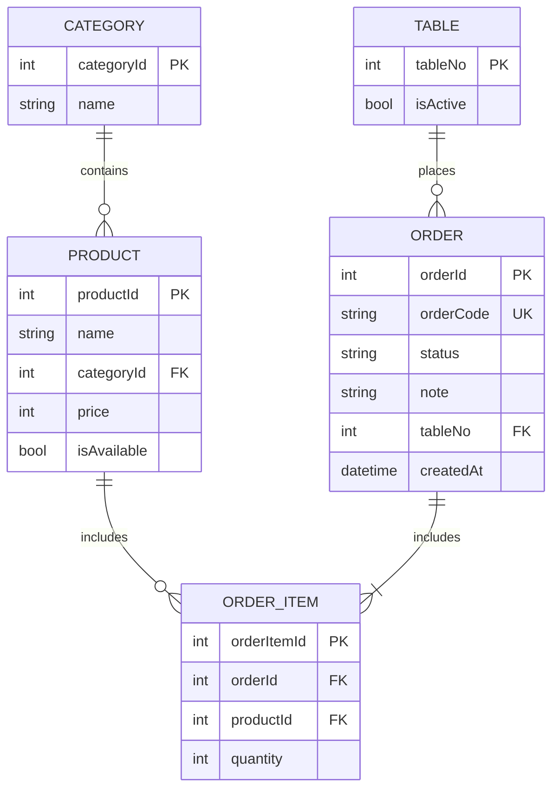

# ADR-001: Database

## Status

Accepted

## Context

- Verimiz birbirine bağlı tablolardan oluşuyor (diyagram bunu gösteriyor).
- Ürün ile sipariş arasında çoka-çok ilişki var, ORDER_ITEM köprü tablo.
- Sipariş ve kalemleri tek seferde kaydedilmeli (transaction).
- Siparişler kısa ömürlü; sipariş geçmişi ve raporlama yok.
- Sistem her restoranda ayrı çalışıyor (single-tenant).

- Category 1 ──── N Product (bir kategoride çok ürün var)
- Table 1 ──── N Order (bir masadan çok sipariş gelebilir)
- Order 1 ──── N OrderItem (bir siparişte çok kalem var)
- Product 1 ──── N OrderItem (bir ürün birçok siparişte yer alabilir)

## Options

| Seçenek    | Artıları                                                                                             | Eksileri                                                                          |
| ---------- | ---------------------------------------------------------------------------------------------------- | --------------------------------------------------------------------------------- |
| PostgreSQL | İlişkisel veri için ideal, transaction desteği güçlü, JSONB ile esneklik, ücretsiz, Docker ile kolay | Şema değişiklikleri migration gerektirir                                          |
| MySQL      | Yaygın, hosting'i kolay, ilişkisel                                                                   | JSON ve gelişmiş özelliklerde Postgres'in gerisinde                               |
| MongoDB    | Şemasız, hızlı prototip, sipariş belgesi gibi iç içe veriler doğal                                   | Sipariş ↔ ürün ↔ masa ilişkileri ve raporlama zorlaşır, transaction daha karmaşık |
| SQLite     | Kurulum yok, öğrenme için harika                                                                     | Eşzamanlı yazmada sınırlı, canlı ortam için uygun değil                           |

## Decision

**PostgreSQL** kullanılacak. ORM olarak **Prisma** kullanılacak.

- Verimiz ilişkisel ve sipariş kaydı transaction gerektirdiği için
- Prisma'dan ileride Knex'e geçiş ihtimali var, bu yüzden Prisma sadece infrastructure katmanında kullanılacak

## Consequences

**Getirdikleri:**

- Sipariş tutarı her zaman ürünün güncel fiyatından hesaplanır.
- Masa numarası doğrudan PK (single-tenant olduğu için)
- unitPrice yok: tutar her zaman güncel fiyattan hesaplanır
- Fiyatlar kuruş cinsinden int

- Docker ile tek komutla çalışıyor, transaction desteği

**Götürdükleri / dikkat edilecekler:**

- Şema değişiklikleri migration gerektirir
- Prisma dışarı sızmamalı (use case'ler Prisma nesnesi değil, kendi entity'lerini kullanır)
- Fiyatlar servis sırasında değiştirilmez
