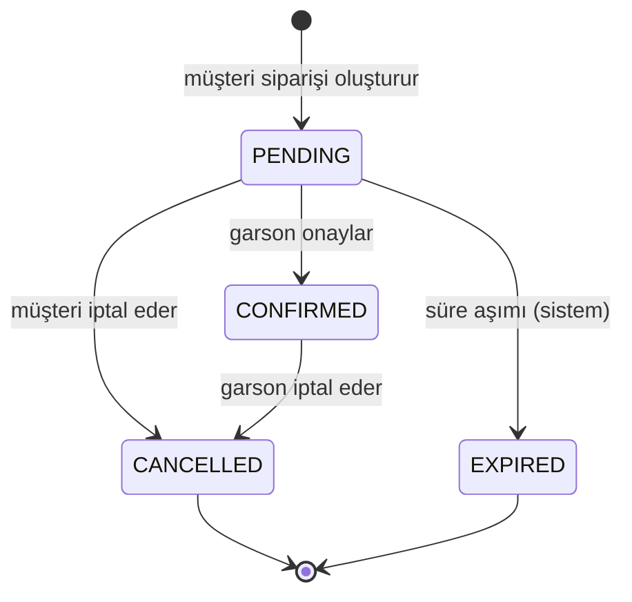

# Order Status Machine

Bu belge `Order` entity'sinin durum (status) kurallarını tanımlar. Faz 5'teki `order.confirm()`, `order.cancel()` gibi domain metotları ve unit testleri bu belgeye göre yazılır.

## 1. Durumlar

| Durum       | Açıklama                                                                      | Son durum mu? |
| ----------- | ----------------------------------------------------------------------------- | ------------- |
| `PENDING`   | Sipariş oluşturuldu, QR üretildi, garson onayı bekleniyor.                    | Hayır         |
| `CONFIRMED` | Garson QR'ı okuttu ve siparişi onayladı. Sipariş artık değiştirilemez.        | Hayır         |
| `CANCELLED` | Sipariş iptal edildi (onaydan önce müşteri, onaydan sonra garson tarafından). | ✅ Evet       |
| `EXPIRED`   | Sipariş süre aşımı içinde (`expiresAt`) onaylanmadı.                          | ✅ Evet       |

Son durumdan (terminal) başka bir duruma geçilemez.

## 2. Diyagram

## 3. Geçiş tablosu

| From        | To          | Tetikleyen | Koşul / Not                                                                                      |
| ----------- | ----------- | ---------- | ------------------------------------------------------------------------------------------------ |
| —           | `PENDING`   | Müşteri    | Sipariş oluşturulur; `expiresAt = createdAt + ORDER_EXPIRY_MINUTES` (varsayılan 15)              |
| `PENDING`   | `CONFIRMED` | Garson     | Sipariş `PENDING` olmalı ve `expiresAt` geçmemiş olmalı. `confirmedAt`, `confirmedBy` doldurulur |
| `PENDING`   | `CANCELLED` | Müşteri    | Değişiklik isteyen müşteri iptal eder, sepeti düzenleyip yeni sipariş (yeni QR) oluşturur        |
| `PENDING`   | `EXPIRED`   | Sistem     | `expiresAt` geçmiş olmalı                                                                        |
| `CONFIRMED` | `CANCELLED` | Garson     | Ör. ürün bitti. Müşteri onaylanmış siparişi iptal **edemez**                                     |

> Garson yerine admin'in de bu işlemleri yapıp yapamayacağı Faz 10'daki rol yetkilerinde netleşecek.

### Süre aşımı (`EXPIRED`) nasıl uygulanır?

Bir sipariş, `expiresAt` geçtiği anda **mantıksal olarak** süresi dolmuş sayılır; veritabanındaki `status` alanının henüz güncellenmemiş olması sonucu değiştirmez.

- **Okurken / işlem yaparken:** `PENDING` görünen ama `expiresAt` geçmiş bir sipariş `EXPIRED` kabul edilir. Garson böyle bir siparişi okutursa onaylayamaz ve "Siparişin süresi dolmuş" mesajı görür. Müşteri ekranında da durum `EXPIRED` görünür.
- **Zamanlanmış iş (sonraki adım):** Periyodik bir iş, süresi dolmuş `PENDING` siparişlerin `status` alanını `EXPIRED` olarak günceller.

## 4. Geçersiz geçişler

**Tabloda olmayan her geçiş geçersizdir.** Geçersiz bir geçiş denendiğinde domain katmanı hata fırlatır; kullanıcı anlamlı bir mesaj görür ve sipariş değişmez.

Öne çıkan örnekler:

| Geçiş                           | Senaryo                                       | Sonuç / Mesaj                                   |
| ------------------------------- | --------------------------------------------- | ----------------------------------------------- |
| `CONFIRMED → CONFIRMED`         | Aynı sipariş iki kez onaylanır                | Reddedilir: "Sipariş zaten onaylandı"           |
| `EXPIRED → CONFIRMED`           | Süresi dolmuş sipariş okutulup onaylanır      | Reddedilir: "Siparişin süresi dolmuş"           |
| `CANCELLED → CONFIRMED`         | Müşteri, garson okuturken siparişi iptal etti | Reddedilir: "Sipariş iptal edilmiş"             |
| `CONFIRMED → CANCELLED`\*       | Müşteri onaylanmış siparişi iptal etmek ister | Reddedilir: "Onaylanmış sipariş iptal edilemez" |
| `CONFIRMED → PENDING`           | Onaylanmış siparişi geri almak                | Reddedilir                                      |
| Son durumdan herhangi bir geçiş | `CANCELLED` / `EXPIRED` siparişi değiştirmek  | Reddedilir                                      |

\* Bu geçiş garson için geçerli, müşteri için geçersizdir.

## 5. Notlar ve kapsam dışı

- **QR okutma durumu değiştirmez.** Okutma sadece okumadır (`GET`), kilitleme yoktur. Sınır, onay (`CONFIRMED`) anıdır.
- **Sipariş kalemleri hiçbir durumda değişmez.** Değişiklik için `PENDING` sipariş iptal edilip yenisi oluşturulur; onaydan sonra ek istek yeni bir siparişle verilir.
- **Sonraki sürüm:** `PREPARING`, `SERVED`, `COMPLETED` durumları ilk sürümde yok. Eklendiklerinde bu belge ve `OrderStatus` enum'u birlikte güncellenir.
